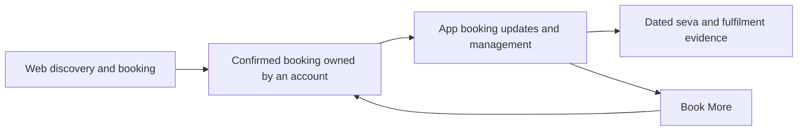

# Start here: Jai Bhakti design workspace

This is the shared design repository for Jai Bhakti. It records the first final
design given for execution on jaibhakti.com, subsequent observations, proposed
web/app changes, experiments and future versioned engineering handoffs. It is
designed to be understood without access to the original agent conversations.

## Understand the product and its history

1. **First final design:** `Jai Bhakti App.html` was handed over for execution on
   jaibhakti.com, as confirmed by the project owner. Its preserved export is
   [JB-BASELINE-001](baselines/JB-BASELINE-001.md). This is an executed-design
   baseline in the project's history. The original handoff date and production
   implementation commit have not been supplied.
2. **Live product:** only the web app is currently live. Six public observations
   dated 13 November 2026 document its presentation. The production source and
   authenticated payment/booking implementation are outside this repository.
3. **New work:** the Daan Seva/My Bookings specification and 49-state app candidate
   propose the next experience. The editable version is under previews/mobile/.
   It uses sample data and remains Draft.
4. **Open exploration:** EXP-0001 compares My Bookings tabs and sections. Neither
   option has been selected. Fifteen inconsistencies are grouped into six decision
   issues; they must be resolved for their affected future handoff scope.
5. **Future handoffs:** new approved packages will be issued as design-vX.Y.Z
   releases. None has been issued through this new release process yet. That does
   not erase the original final design's historical execution handoff.

The filename “App” does not establish a shipped native app. The owner describes
the original as the design supplied for the website's execution.

## Understand the intended user flow

The web supports discovery and booking. The mobile app is intended to show booking
updates, ongoing sevas, upcoming registered dates, performed dates and their media,
beneficiaries and payment recovery, while also allowing Book More. Web and app must
agree on account ownership, catalogue/prices, purchased terms and booking records.

This is the intended cross-platform contract. The current prototype demonstrates
sample states; it does not prove web-to-app synchronization. Whether Book More
initially reuses web checkout or uses native checkout is an open decision.

## See the designs before editing

Read [the access guide](docs/00_Review_the_Whole_Design.md). For a visual review,
download the complete repository and open index.html, or serve it with
`python3 tools/serve_design_hub.py` and open http://localhost:8000.

- [Guided walkthrough](walkthroughs/index.html): the original's 12 entry states,
  a suggested current-app journey, the A/B exploration and a browser for all 49
  app draft states. Use Next, Previous or the screen selector. Historical screen
  stepping works through the local server/Codespaces; file-only review retains
  frozen captures as a fallback.
- [Visual explorations](explorations/index.html): review both current layout
  alternatives and their open question.
- [Full editable prototype](previews/mobile/Prototype.html): freely navigate all
  states using the sidebar or All screens on a narrow display.
- [Reference gallery](previews/mobile/Gallery.html): frozen imported screenshots
  beside links to current working routes. Captures do not update automatically.

GitHub renders Markdown but displays HTML as source. Open HTML through the local
hub or [Codespaces](https://codespaces.new/suyashb734/jaibhakti-design).
An export for static hosting can be prepared with tools/build_preview_site.py;
building it is not publication. Public hosting allows anyone to view/share it.
Noindex requests reduce discoverability and do not restrict access.

## Know which record to trust

| Question | Record |
| --- | --- |
| What was first finalized and handed over? | [Historical baseline](baselines/JB-BASELINE-001.md) and unchanged original export |
| What did the live site show on the audit date? | references/live-web/2026-11-13/observations.json |
| What is the proposed next behavior? | Specification inputs, contracts/ and changes/JB-CHG-0001/README.md |
| Which options remain exploratory? | explorations/ and registries/explorations.json |
| What is the latest integrated draft? | previews/ and registries/changes.json |
| What is final for the next engineering delivery? | Approved releases/index.json entry, exact source commit, evidence and human approvals |
| What actually shipped? | Implementation/staging/live verification links; do not infer it from a design merge |

The old final baseline explains what was handed over, while dated live evidence
explains what was observed. Neither silently settles new product conflicts. Use
an explicit decision for changed prices, duration, beneficiary or cancellation
behavior. Preserve the accepted terms of existing purchases.

## Start an agent session

1. Read [AGENTS.md](AGENTS.md), this guide and [CONTRIBUTING.md](CONTRIBUTING.md).
   CLAUDE.md imports the same agent policy.
2. Check Git status, current branch and commit. Identify the human owner, assigned
   issue, EXP/JB-CHG ID, baseline and permitted files. Use an isolated branch and
   checkout/worktree for concurrent tasks; preserve unrelated edits.
3. Read the package and its decision dependencies. For the first change start with
   [JB-CHG-0001](changes/JB-CHG-0001/README.md), [EXP-0001](explorations/EXP-0001/README.md),
   [the source audit](docs/01_Source_Audit.md) and [the platform model](docs/02_Web_and_Mobile_Model.md).
4. Follow stable IDs: SRC is a source, JB-BASELINE a historical handoff, EXP an
   exploration, JB-CHG a change, JB-REQ a requirement, JB-APP/JB-WEB/JB-REF a screen,
   INC an inconsistency and DEC a decision. JSON registries provide their mappings.
5. Put experiments in their EXP folder; integrate selected work into previews/ via
   a change package. Treat contract/token/copy dependencies as part of the review.
6. Run integrity validation; for UI work check affected routes and collect
   comparable evidence. Run governance tests when tooling changes. Record what
   passed, failed and was not tested. Submit a scoped PR with the measurements.
7. Leave finalization to the recorded human review process. A selected experiment,
   merged PR or green CI does not authorize the next engineering delivery.

Useful starting prompt for another agent:

> Read AGENTS.md and START_HERE.md, then the package for my assigned issue. Report
> the historical baseline, current draft, open decisions, task scope and validation
> needed before editing. Preserve immutable references and work in an isolated
> branch. Record changes and evidence for human review; do not infer final approval.

## Complete the design-to-engineering flow

Explore → human selects a direction → integrate a draft → measure and review the
exact revision → human product/design approval and engineering acknowledgement →
versioned handoff → implementation → staging/live verification.

Use [the workspace workflow](docs/06_Shared_Design_Workspace.md),
[measurement protocol](docs/04_Measurement_Protocol.md) and
[handoff gate](docs/05_Engineering_Handoff.md). Operations/payments confirms affected
rules. A new source revision needs renewed review; a new release preserves prior
history and states its superseded scope.

## Current next work

The [private project](https://github.com/users/suyashb734/projects/1) contains six
decision issues, JB-CHG-0001 and EXP-0001. Next, assign actual human owners and
reviewers, resolve the scoped commercial/identity decisions and compare the two
layouts with identical tasks and fixtures. Implement one coherent checkout-to-app
design slice before issuing the next final handoff. Full milestones are in
[PLANS.md](PLANS.md).

Named product/design/engineering roles, required branch reviews and release
protections remain pending. CODEOWNERS currently routes maintenance review to the
repository owner. Do not represent the written workflow as enforced permissions.
