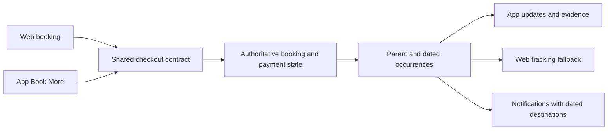

# Jai Bhakti web and mobile model

Manage Jai Bhakti as one product with two interfaces and one authoritative booking record. Shared rules, identity, catalogue and fulfilment state should drive both. Channel-specific layouts and navigation can differ.

## Platform responsibilities

| Capability | Web | Mobile app | Shared contract |
| --- | --- | --- | --- |
| Discovery and product details | Primary acquisition and campaign destination | Discover, repeat and book more | Product/package/temple identity, availability, pricing and copy |
| Booking and authorization | Complete booking funnel | Book more using an agreed checkout implementation | Same beneficiary, price, consent and registration semantics |
| Confirmation | Show actual confirmed or pending state and receipt | Resume the same booking | Server-confirmed payment and registration, never a client redirect alone |
| Tracking | Accessible receipt and tracking fallback | Primary home for ongoing updates and history | Same parent and dated occurrence IDs and state |
| Media | Open a relevant link when app is unavailable | In app certificate/video experience | Same asset records and readiness, per occurrence |
| Notifications | Web destinations and WhatsApp continuity | Push and app deep links | Same event, occurrence and source record |
| Management | Fallback access and support | Nirantar, beneficiary and payment views | Same mandate state and approved management rules |

Do not make installing the app a condition for understanding a web purchase. Keep a browser destination for confirmation, pending status and relevant tracking or support.

## Checkout recommendation

Keep one checkout contract. For an initial app release, reusing the established web checkout can reduce duplicated payment behavior, provided the payments team verifies the browser/SDK choice, authentication continuation and return links. The app can still offer Book More and retain the selected offer and beneficiary. A native checkout is also possible, but should implement the same contract and pass the same scenarios. This implementation choice remains a decision; no mobile framework or payment provider integration is selected by this repository.

Do not embed the original prototype’s simulated UPI PIN entry as a Jai Bhakti payment form. Treat provider authorization as a provider-controlled handoff with documented pending, cancellation, failure and return behavior.

## Proposed shared records

These are semantic requirements for engineering discussion, not implemented API routes or approved backend field names.

| Record | Stable identity and meaning |
| --- | --- |
| Account | Owns bookings across web and app; distinct from phone contact and beneficiary |
| Product and package | Purchased offering and price configuration, linked to the actual temple |
| Beneficiary | Person receiving the seva; account holder and payer may differ |
| Nirantar booking | Ongoing relationship with cadence and associated mandate reference |
| Mandate | Provider state and actual authorized terms, expiry or cancellation events |
| Dated occurrence | One eligible registered date and its fulfilment state, amount and evidence |
| Payment attempt | Charge, provider result, retry relation and idempotency context |
| Receipt | Payment or registration acknowledgement; distinct from performed-seva proof |
| Certificate and video | Independently ready assets attached to one performed occurrence |
| Notification | Event delivery pointing to the existing booking or occurrence |

Snapshot purchased price, beneficiary details and accepted terms for each applicable record. Current catalogue edits must not rewrite old bills or certificates. Unknown gotra assignment needs an explicit source and an approved policy. Use server-issued identifiers; do not join records by deity name, display text, phone alone or an unverified URL parameter.

## Web to app continuity

Define one verified account ownership and recovery model before handoff. Resolve guest purchase claiming, duplicate accounts, phone changes and access to legacy web bookings. Returning from checkout must refresh authoritative status and open the exact occurrence or parent. App-installed, app-missing, expired-link, interrupted-checkout and signed-out cases need explicit destinations. Do not put raw beneficiary data or reusable credentials in a deep link.

## First complete review journey

Use the observed Rahu ₹51/₹121 example plus the Gaj Mahalakshmi ₹51/₹101 example. A web booking by an account holder for another beneficiary must appear in the same account in the app, with matching product and temple IDs, actual charge, cadence and date. Follow it through Scheduled, Performed, certificate ready with video preparing, and completed evidence. Include a second beneficiary, failed charge, next-date retry success, cancellation sync and a legacy purchase. Keep account, beneficiary, parent, occurrence, payment and asset IDs visible in the fixture data.

The actual outcomes for already paid occurrences after cancellation, legacy fixed-term conversion and retries crossing cadence cutoffs remain decisions in the inconsistency register.
