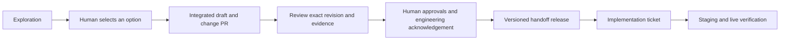

# Shared explorations, design review and final handoff

Use GitHub as the record of design work and human decisions. Keep experiments
discoverable without presenting them as instructions to build. A merged draft is
useful shared work; only an explicitly approved release is a tech handoff.

For project history and the complete user/agent flow, start with
[START_HERE.md](../START_HERE.md). The original Jai Bhakti App.html was already
finalized and given for website execution, as recorded in JB-BASELINE-001; the
release workflow below governs the newer changes.

Read [the connected collaboration guide](07_Preview_and_Collaboration.md) for task branches, isolated options, the existing shared A/B source and preview refresh after main merges.

## The four places to look

| Area | Purpose | Authority |
| --- | --- | --- |
| references/ and baselines/ | Original exports, owner-confirmed execution handoff and dated live observations | Historical final design and observed evidence, preserved unchanged |
| explorations/EXP-xxxx/ | Alternatives, hypotheses, experiments and findings | Proposals; even a selected option needs integration and approval |
| previews/ and changes/JB-CHG-xxxx/ | Integrated web/app draft and its change rationale, scope and evidence | Reviewable working design, with status per revision |
| releases/ and GitHub Releases | Exact approved source version, included scope, evidence and human approvals | Engineering handoff contract for the specified scope |

`main` is the latest shared work, not a final-design branch. Avoid separate
permanent exploration and final branches: they drift and obscure which files
were reviewed. Use short-lived branches, recorded statuses and versioned handoffs.
Do not copy the entire application into a new folder for every change.



Exploration is optional for a straightforward correction. A draft can return to
exploration or review without changing the meaning of an earlier released version.

## Explorations have outcomes, not approvals

An EXP record uses `active`, `selected`, `parked` or `rejected`. Record the owner,
question, baseline commit, alternatives, comparison criteria, findings and outcome
rationale. Selected means a human chose an option for a linked JB-CHG package;
it does not mean the integrated design is ready to build. Parked and rejected
records remain searchable so later agents do not repeat the same work unknowingly.

Use [the exploration template](../templates/exploration.md). Small experimental
HTML/assets may live in its folder and must say Exploration visibly. Link existing
alternatives instead of duplicating them. Larger videos and repeated captures
belong in review artifacts. Changes to shared tokens, copy or commercial behavior
must be deliberately reviewed when integrating an option.

The [first exploration](../explorations/EXP-0001/README.md) documents the existing
My Bookings A/B alternatives. Neither has been selected. This preserves an actual
open question rather than inventing a final direction.

## Integrated changes and versioned approval

Changes use `draft`, `in_review`, `approved_for_build` or `retired`. Approval is
always for a specific source revision and scope; the status of a working file is
not permanent approval for all future edits. A candidate handoff is a draft or
pre-release. A final handoff uses a stable `design-vX.Y.Z` release with named human
approval records, acceptance evidence and engineering acknowledgement.

Keep one integrated preview per platform. A JB-CHG package references affected
paths, IDs and commits rather than holding another full source tree. Normal review
needs comparable before/after evidence, affected requirements and scenarios,
intentional differences, dependencies and explicit omissions. A small copy change
needs proportionate evidence; a payment or ownership rule needs its actual cases.

An approval record names the human, role, timestamp, exact source commit and review
URL. One human may fulfil more than one role, explicitly. Product and design are
required; engineering acknowledges feasibility and receipt; operations/payments
confirms affected rules. Agents prepare proposals and evidence but cannot replace
these human decisions. Record the exact release in each implementation ticket.

Approved evidence must outlive CI retention. Preserve it with release assets and
checksums. Do not silently edit or move an issued version: issue a new version and
state which earlier scope it supersedes. Git history and checksums provide an audit
trail; tag/asset immutability is a policy until GitHub protections are enabled.
GitHub also offers [immutable releases](https://docs.github.com/en/code-security/concepts/supply-chain-security/immutable-releases),
which lock a published release's tag and assets when enabled. No final release
or immutable-release enforcement has been configured by this setup.

## Multiple people using Codex and Claude

Each task has one accountable human and one EXP/JB-CHG issue. Assign the issue or
record a claim with scope before work; unassigned does not mean an agent owns it.
Use each person's own GitHub account. Give every concurrent task its own branch
and checkout or worktree. For example, from a clean clone:

```bash
git fetch origin
git worktree add -b explore/EXP-0002-yourname-topic ../jb-exp-0002 origin/main
```

Choose an unused ID first. Start the agent inside that worktree, confirm its branch
and Git status, and provide the issue, baseline and permitted files. Coordinate
shared contract/token edits before parallel work. Rebase or merge current main
before final review, inspect the resulting diff and repeat affected checks.

[AGENTS.md](../AGENTS.md) is the common policy.
[CLAUDE.md](../CLAUDE.md) imports it so rules stay consistent across installations.
Codex's [repository instruction documentation](https://developers.openai.com/codex/guides/agents-md/)
and Claude Code's [shared instruction guidance](https://code.claude.com/docs/en/memory#share-one-file-with-other-coding-tools)
describe these mechanisms. Ask the agent to report loaded instruction files at the
start of a session. Instructions guide agents; they do not enforce GitHub access
or prevent a privileged user bypassing review.

Use a PR to make each exploration or integrated change reviewable. The merge
review checks its quality and documentation, not whether it is authorized for
development. A later handoff review records approval for the exact included design.
If feedback changes that source or its dependencies, collect approval again for
the new revision. Repository tooling maintenance is separate from product signoff.

## A lightweight project view

Use the private [Jai Bhakti Design Workspace](https://github.com/users/suyashb734/projects/1)
for the queue. The built-in Status column represents design state; Work type and
Implementation state are separate fields, with the responsible human recorded in
Assignees and the package. Issue closure means that task ended; it does not prove
the design was approved, submitted or shipped.

Useful views are explorations, review queue and engineering handoffs. Treat the
board as navigation; the change record and approved release are the evidence.
Project access and private-repository access are separate: add actual collaborators
to both as needed. No collaborator roster or review teams have been supplied yet.

The current project and issue links are in registries/project.json. Board fields
are maintained manually, not synchronized to JSON by an agent. Required PR checks,
reviewer roles and release-tag restrictions should be configured once the actual
people and account capabilities are known. CODEOWNERS currently names only the
repository maintainer, not all approval roles; those controls are not yet enforced.

For lasting team ownership, move the repository and project into a Jai Bhakti
GitHub organization when its owner/admins are established. Keep individual logins,
give contributors edit access and engineering review access as needed, and use
named teams for approval routing. The current workspace remains under the existing
personal account; no transfer or collaborator invitations have been performed.

## Other tools

For this existing HTML/CSS/JavaScript workflow, start with GitHub plus the clickable
review hub. This keeps agent changes and the measured source together. Add Figma
if humans need direct canvas editing, component design or visual annotations.
Figma has [development handoff views](https://help.figma.com/hc/en-us/articles/23918228264855-Dev-Mode-ready-for-dev-view),
with availability depending on plan and seat. It can be an authoring/review surface
while GitHub keeps the change and release record.

If Figma is adopted, name the editable authority for each artifact. Pin its reviewed
file version/frame links and retain an export in the handoff. Do not independently
maintain the same screen as equally authoritative HTML and Figma sources. A second
task tracker or wiki is unnecessary unless the team already works there; link it
rather than duplicating approval records across tools.

## Rollout and acceptance

The exploration layer, common agent instructions, templates and review entry points
are repository setup. Next, name the product/design approvers and engineering
recipient, then use EXP-0001 and JB-CHG-0001 as the first real workflow trial.
Resolve scoped decisions, compare both layouts with identical fixtures, record the
human selection, integrate and measure the chosen direction, and release only the
approved scope. Unrelated explorations can continue throughout.

The model is working when a new contributor can find experiments and their
outcomes, locate the latest integrated draft, identify precisely what engineering
may build, and trace its eventual implementation without relying on a chat thread.
