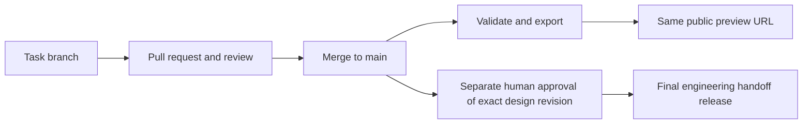

# Connected preview and collaborative editing

The shared review URL is
[suyashb734.github.io/jaibhakti-design-preview](https://suyashb734.github.io/jaibhakti-design-preview/).
The URL stays the same as the exported designs change. Its content is a review
preview, with original-final, draft and exploration statuses shown explicitly.

## How it stays connected

The private jaibhakti-design repository is the authoring source. Its Publish review
preview Action validates a clean main revision, builds an explicit static export,
and pushes the generated files to the public jaibhakti-design-preview repository.
GitHub Pages publishes that repository's main branch. Relevant preview changes
merged into main refresh the site; a branch by itself does not change the shared
preview. The Action can also be run manually on main.



The site shows the latest successfully published snapshot, not changes still being
edited in a branch. Check [the publish workflow](https://github.com/suyashb734/jaibhakti-design/actions/workflows/publish-preview.yml)
and the site's preview-info.json for the source commit. If publishing fails, the
previous site remains available. Pages deployment can take a few minutes.

Public preview files, imagery and code are accessible to anyone and can be shared.
Noindex requests are included; they are not authentication. The full documentation,
requirements, decision records and source history stay in the private design
repository. The account's current plan does not support Pages from this private
repository, which is why the generated export has its own public repository.

The automation uses a deploy key scoped to the public preview repository and an
encrypted Actions secret in the private repository. No personal access token or
private key belongs in source files. The maintainer can revoke the public deploy
key and rotate DESIGN_PREVIEW_DEPLOY_KEY if needed. Never edit the generated public
files to author a design; change the private source and publish from there.

## Does every exploration need its own permanent branch?

No. The exploration's permanent home is its EXP ID, issue and folder. Each focused
editing task uses a short-lived branch and PR. Several successive branches can
improve EXP-0001 over time; their merged history stays with the same exploration.
Use a separate checkout/worktree per concurrent person or agent.

For example, from a clean source clone:

```bash
git fetch origin
git worktree add -b explore/EXP-0001-yourname-card-spacing ../jb-exp-0001-card-spacing origin/main
```

Start Codex or Claude inside that worktree. Give it the EXP ID, option, issue,
baseline, human owner and permitted files. An example instruction is:

> Read AGENTS.md and START_HERE.md. Work on EXP-0001, Option A card spacing. Keep
> the original-final branding. Preserve Option B and product rules. Identify shared
> source dependencies, capture comparable before/after evidence and open a PR for
> human review. Do not mark the exploration selected or the new design approved.

## Editing one particular option

1. Claim the issue or record the accountable human and scope. Check other active
   work on the same files before starting.
2. Choose whether this is a refinement of the integrated draft or an isolated
   experiment. The existing A/B routes both live in
   explorations/EXP-0001/draft/assets/screens/bookings.js and share components, styles and
   fixtures. Review both when changing shared files. Use the
   [editing map](../previews/mobile/README.md) to agree file scope.
3. For a new alternative, put its preview under
   explorations/EXP-0001/options/your-variant/ rather than overwriting another
   option or replacing the integrated draft. Reuse the shared original-brand assets
   and realistic fixtures. Link it from the EXP record and exploration page.
   Public assets in these option folders are included in the static export.
4. Record the question, baseline, affected IDs, changes and limitations. Update the
   EXP register and relevant decision links. Compare identical fixtures/tasks and
   viewports, with results proportional to the change.
5. Run integrity checks, catalogue checks and any affected UI checks. Open a PR
   from the task branch. The PR states which option changed, what remains open and
   where reviewers can run that branch locally or in their own Codespace.
6. After human repository review, merge the proposal into main. Its public preview
   then refreshes. This makes the experiment available for discussion; it does not
   mean the option was selected or approved for engineering.
7. Record an actual human outcome: active, selected, parked or rejected. Selection
   promotes a direction into a JB-CHG integration/review package. Final approval
   still needs the exact version, scope, evidence and engineering acknowledgement.

Two people can work on different options simultaneously using separate files and
branches. For the same source or shared tokens/contracts, agree scope first and
merge sequentially. Git can merge text that still contains conflicting product
decisions; review the combined behavior as well as the diff.

## Review, finalization and implementation

Keep three decisions distinct: merge a documented proposal, select an exploration
outcome, and approve an exact engineering handoff. Repository review checks whether
the proposal is fit to share. Product/design review approves the integrated
version; operations/payments confirms affected rules; engineering acknowledges
feasibility and receipt. A design-vX.Y.Z release is the next execution contract.

Approved release records remain pinned while new experiments continue. Engineering
uses its named release, not whichever draft happens to be visible at the shared
URL later. Implementation tickets and staging/live evidence link to that same
version. The original historical handoff stays recorded as JB-BASELINE-001.

Required GitHub branch reviews and actual reviewer teams remain to be configured
once the collaborator roster is known. These workflow rules are written policy;
CODEOWNERS currently names only the maintainer.
